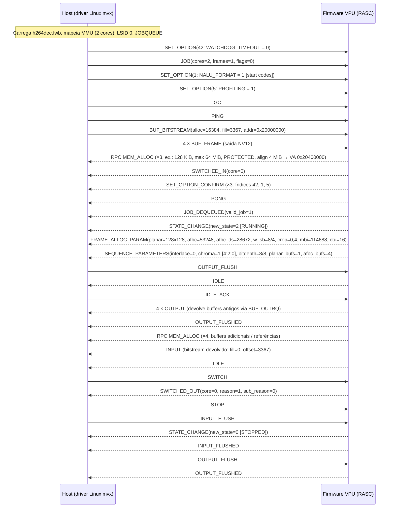

<!-- SPDX-License-Identifier: CC-BY-SA-4.0 -->

# Sequências Observadas em Hardware Real, Armadilhas e Lacunas Abertas

Este documento registra as evidências empíricas coletadas em placas reais (**SpacemiT K1 BPI-F3** e **SpacemiT K3 Pico ITX**), as armadilhas de plataforma descobertas durante o *bring-up* de firmware próprio nas CPUs RASC e o catálogo atualizado das **lacunas de hardware ainda abertas** para os marcos avançados de aceleração de vídeo (M4–M6).

---

## 1. Traço Real de Sessão H.264 Decode no SpacemiT K1 (`[O]`)

Capturado via `debugfs` (`amvx/log/drain/ram0/msg`) no SpacemiT K1 com um stream H.264 Baseline Annex-B de **128×128, 5 frames (3367 bytes)**, saída **NV12** (4 buffers de captura), produzindo 122.880 bytes (`5 × 128 × 128 × 1,5`) sem erros:

### Fatos Comportamentais Confirmados por Este Traço (`[O]`)

1. **Lote inicial já enfileirado no boot:** O driver enfileira `SET_OPTION`, `JOB`, `GO`, `PING` e buffers antes mesmo de receber o primeiro `SWITCHED_IN`.
2. **Escalonamento multi-core independente da resolução:** O driver solicitou `cores = 2` mesmo para 128×128; o firmware aceitou e completou o decode.
3. **Alinhamentos amplos em RPC `MEM_ALLOC`:** Pedidos típicos usam `size = 128 KiB`, `max_size = 64 MiB`, `region = 0 (PROTECTED)`, `log2_alignment = 22 (4 MiB)` (VA retornado `0x2040_0000`).
4. **Handshake de realocação pós-`SEQUENCE_PARAMETERS`:** O host sempre envia `OUTPUT_FLUSH` após receber `FRAME_ALLOC_PARAM` + `SEQUENCE_PARAMETERS`.
5. **Switch-out por ociosidade:** `IDLE` → `SWITCH` → `SWITCHED_OUT(core=0, reason=1, sub_reason=0)`, seguido de `0xFF02B030 = 1`, retornando `CORELSID` para `0x0000_00FF` (K1).

---

## 2. Validação de Firmware Próprio Clean-Room no Silício do K1 (`[O]`)

Um firmware mínimo construído do zero com `rasc-elf-gcc` 4.2.3 + binutils 2.18 executou diretamente na CPU RASC0 do SpacemiT K1 e trocou mensagens MVE válidas com o driver Linux `mvx`:

| Teste em Silício (K1) | Resultado Observado | Implicação para o Time Limpo |
|---|---|---|
| Execução de `_start` via trampolim `br` no offset `0x00` | Sucesso (`VA 0x1000` salta sobre o header de 180 B) | Obrigatório colocar `br _start` em `rasc_jmp` e incluir os 180 B em `text_length` |
| Inicialização de pilha com `lpc sp, stack_top` | Sucesso em qualquer instância de core | Proibido usar endereço absoluto fixo para `sp` |
| Aritmética escalar e shifts (`movh`, `movw`, `movn`, `add`/`adc`) | `movh = <<1`, `movw = <<2`, `movn = ~imm`, carry funcional | Usar exatamente estas semânticas |
| `push`/`pop` de `r13..r14` | Restaurados corretamente (`rN` no menor endereço, `r14` no maior) | Compatível com `rasc-elf-gcc` e frame de exceção |
| BCC3 com skip de 2 instruções de 3 bytes | Saltou exatamente 2 instruções (6 bytes) | BCC3 conta instruções variáveis, não múltiplos de 2 bytes |
| Número de CR de 8 bits (`mtcr`/`mfcr`) | `CR 0x94` ≠ `CR 4` no silício | Nunca truncar número de CR para 4 bits |
| Envio de `MVE_RESPONSE_CODE_ERROR` (`2010`) via `MSG_OUTQ` + `CR14 = 0` + `0xFF02B028 = 1` | Driver Linux recebeu IRQ 74, leu `MSG_OUTQ` e exibiu o payload intacto no `dmesg` | Transporte MVE FW→Host 100% provado em silício |

---

## 3. Armadilhas Críticas de Plataforma (Lições Aprendidas) (`[O]`)

1. **`text_length` sem os 180 bytes do header trunca o firmware silenciosamente.**
2. **Descasamento entre o alvo do trampolim `br` (offset `0x00`) e o offset de linkagem de `_start`** faz a CPU saltar no meio do código.
3. **Escritas em CRs estendidos (`0x90`/`0x93`/`0x94`) e coerência:** Evitar escrever em CRs de coprocessadores não caracterizados durante o bring-up escalar (efeito colateral de cache/estado observado no K1).
4. **Tradução DMA de 2 GiB no K1 (`phys_cpu2vpu`):** Páginas físicas acima de `0x1_0000_0000` (CPU) requerem subtração de `0x8000_0000` nos PTEs da MMU.
5. **Processo V4L2 preso em estado `D`:** Se o firmware experimental não responder, a sessão só libera após `watchdog_timeout` do driver (default 30 s) ou `TERMINATE`/reset do bloco.
6. **Bug do `rasc-elf-as` 2.18:** Nunca passar endereços numéricos literais a `bsr` ou `lpc` em `.S` (causa segfault); use sempre rótulos simbólicos.

---

## 4. Registro Formal de Lacunas de Hardware em Aberto

As lacunas do **plano de controle** (boot multi-RASC, `CR0` VBAR, `CR4` base de instância, `CR16` cycle counter, `CR18` `RASC_ID`, `clri`/`seti`, spinlock `0xFF02B038`, `IRQHOST` bit 18 + clear `0xFF02B02C`, switch-out `0xFF02B030`, watchdog `0xFF025000`, 8 bus masters MMU `0xFF024010+`, `HARDWARE_ID` / revisão interna / capacidades DSL em `0xFF02B068..7C`, e as bases de todos os 6 blocos de vídeo `0xFF04_0000`..`0xFF18_0000`) **já estão fechadas** nesta especificação (Marcos **M1, M2 e M3** prontos para implementação!).

Permanecem em aberto para futuras rodadas de especificação (foco nos Marcos **M4–M6**):

| ID | Área | O Que Ainda Falta Especificar | Impacto / Marco |
|---|---|---|---|
| **G1** | Plano de Dados — Programação dos Blocos de Vídeo | Sequência exata passo a passo de programação de registradores (offsets, bitfields e polls de conclusão) dentro de `BITSTREAM` (`0xFF04_0000`), `REF` (`0xFF08_0000`), `ME` (`0xFF0C_0000`), `MC` (`0xFF10_0000`), `TRF` (`0xFF14_0000`), `DBL` (`0xFF18_0000`), `SDMA` (`0xFF02_1000`) e `VDMA` (`0xFF02_2000`) para executar um quadro completo (começando por JPEG em M4 e H.264 em M5) | **M4–M6** (não bloqueia M1–M3) |
| **G2** | Bancos de Coprocessadores via CR (`0x20`–`0xFF`) | Semântica individual dos bancos estendidos de registradores de controle acoplados aos aceleradores (`CR 0x20..0xFF`), incluindo os efeitos colaterais de cache/estado observados em `CR 0x90`/`0x93`/`0x94` | **M4–M6** |
| **G3** | Bits de `SR` e Linhas de IRQ Auxiliares | Mapeamento completo de todos os bits do *Status Register* (`SR`), significado exato de cada bit de `CR3 = 0x1A7`, `CR6 = 0x200`/`1`, e mapeamento das linhas de IRQ auxiliares dos blocos aceleradores de vídeo (além dos bits 1, 3, 4, 17, 18 e 23) nos controladores `0xFF02_6000..0xFF02_A000` | **M3–M5** (não bloqueia M1–M2) |
| **G4** | Registradores Host `CONFIG`, `PROTCTRL`, `INTSIG` | Significado bit a bit de `CONFIG` (`0xFFFF6402` K1 vs `0xFFFF7404` K3), `PROTCTRL` (`0x1`) e `INTSIG` | Baixa prioridade (driver Linux já os gerencia) |
| **G5** | ISA — `rrx` e Extensão Vetorial `v*` | Comportamento exato de `rrx` e semântica por lane das instruções vetoriais `v*`/`vf*` | Não bloqueante (não usadas pelo GCC nem no plano de controle) |

---

*Licença: [CC-BY-SA-4.0](LICENSE) — Creative Commons Attribution-ShareAlike 4.0 International.*
